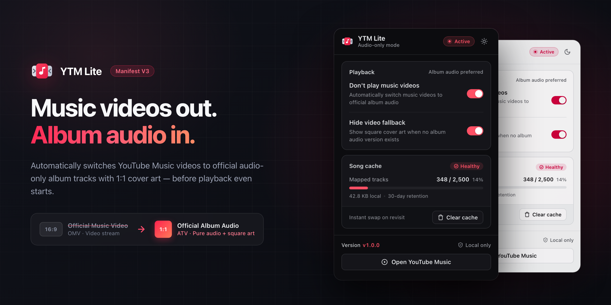

<div align="center">
  
  <h1>YTM Lite</h1>
  <p><b>Pure album audio on YouTube Music — no music videos.</b></p>
  <p>Automatically intercepts music videos before playback and switches to official audio-only album tracks<br>with high-resolution square cover art, zero video flash, and a local 30-day song cache.</p>

  <p>
    <a href="https://github.com/fadhilafif98/ytm-lite/releases/latest">
      
    </a>
    
    
    <a href="PRIVACY.md">
      
    </a>
    <a href="LICENSE">
      
    </a>
  </p>

  <p>
    <a href="#how-it-works">How it works</a> ·
    <a href="#what-you-get">Features</a> ·
    <a href="#install">Install</a> ·
    <a href="#privacy--permissions">Privacy</a> ·
    <a href="#project-structure">Architecture</a>
  </p>
</div>

<p align="center">
  
</p>

## How it works

YouTube Music frequently queues Official Music Videos (`OMV`) or user uploads (`UGC`) inside mixes, playlists, and search results — even when a clean official Audio Track Video (`ATV` / album version) exists. YTM Lite fixes this at the network layer before the video stream ever loads.

- **Pre-playback interception.** Hooks `/youtubei/v1/player`, `/next`, `/browse`, and initial hydration payloads (`YTMUSIC_INITIAL_DATA`) at `document_start` to swap known music video IDs to their official `ATV` audio counterparts seamlessly.
- **3-stage smart resolver.** When an unmapped track plays, YTM Lite pairs official album playlists (`VLOLAK5uy_`), runs songs-filtered search, and falls back to the artist's official YouTube Music catalog — guarded by strict title, artist, duration, and variant matching (preserving remixes, live, acoustic, sped-up, and slowed versions).
- **Local cache & graceful fallback.** Resolved mappings and `544×544` square album covers are cached locally for 30 days (up to 2,500 tracks) for instant swaps on revisit. If no album audio version exists, an optional square cover-art fallback hides the video player while keeping advertisements completely untouched.

```
Music Video (OMV / UGC)
  ├── Local Cache Hit (30-day TTL) ──▶ Instant swap before /player loads
  ├── Counterpart / Album VL Pairing ─▶ Zero extra search requests
  ├── 3-Stage ATV Resolver ───────────▶ Official album audio + 1:1 cover art
  └── No Official Audio Exists ───────▶ Optional square cover fallback (ads untouched)
```

## What you get

● enabled by default · ○ configurable in popup

| Feature | Behavior | Status |
| --- | --- | :---: |
| **Auto-switch to album audio** | Rewrites music videos (`OMV` / `UGC`) to official `ATV` album tracks before playback | ● |
| **Rolling queue lookahead** | Pre-resolves the next 3 queued tracks in the background; cancels immediately on track skip | ● |
| **Variant protection** | Keeps remixes, live sessions, acoustic, instrumental, slowed, and sped-up tracks intact | ● |
| **Square album art & clean metadata** | Replaces 16:9 video thumbnails with `544×544` album covers and strips view/like counts | ● |
| **Hide video fallback** | Displays clean square cover art when no official audio version exists (never hides ads) | ○ |
| **Persistent local song cache** | Stores up to 2,500 mappings in `chrome.storage.local` with live quota bar & one-click clear | ● |
| **Adaptive Light & Dark popup** | Follows system color scheme automatically with an instant header theme override | ● |

## Install

YTM Lite works on **Google Chrome (111+)**, **Microsoft Edge**, **Brave**, **Arc**, **Vivaldi**, and other Chromium-based browsers.

### Option 1: Download Release `.zip` (Recommended)

1. Download the latest `ytm-lite-v*.zip` from [GitHub Releases](https://github.com/fadhilafif98/ytm-lite/releases/latest) and extract the folder.
2. Open your browser's extensions page:
   - Chrome: `chrome://extensions`
   - Edge: `edge://extensions`
   - Brave: `brave://extensions`
3. Enable **Developer mode** (top-right toggle).
4. Click **Load unpacked** and select the extracted `ytm-lite` folder.
5. Open [YouTube Music](https://music.youtube.com) — audio-only mode is active immediately.

### Option 2: Clone from Source

```bash
git clone https://github.com/fadhilafif98/ytm-lite.git
```

Then load the cloned `ytm-lite` folder via **Load unpacked** in `chrome://extensions`.

> [!NOTE]
> No build step, bundler, or `npm install` is required. YTM Lite is pure vanilla JavaScript, HTML, and CSS built directly for Manifest V3.

## Privacy & Permissions

YTM Lite runs **100% locally** inside your browser. There are no external servers, no analytics, no telemetry, and no account credentials accessed or transmitted. Read the full disclosure in [PRIVACY.md](PRIVACY.md).

| Permission / Scope | Why it is needed |
| --- | --- |
| `storage` | Syncs your two toggle preferences via `chrome.storage.sync` and stores resolved song mappings locally via `chrome.storage.local`. |
| `https://music.youtube.com/*` | Injects the playback resolver and optional square cover-art stylesheet exclusively on YouTube Music. |

## Project Structure

<details>
<summary>View files and module responsibilities</summary>

```text
ytm-lite/
├── manifest.json       # Chrome Extension Manifest V3 definition
├── inject.js           # MAIN-world fetch/XHR & YTMUSIC_INITIAL_DATA interceptor
├── content.js          # Isolated-world settings bridge, cache sync & native Song toggle watcher
├── content.css         # Audio-only 1:1 cover layout for fallback mode (preserves ads)
├── popup.html          # Extension popup layout
├── popup.css           # Adaptive Light/Dark design tokens & component styles
├── popup.js            # Popup controls, theme toggle, live cache usage & storage listeners
├── theme-init.js       # Synchronous color-scheme hydration (FOUC prevention, MV3 CSP safe)
├── src/
│   ├── matcher.js      # Title/artist/duration/variant scoring & payload extraction
│   ├── cache.js        # Session & memory mapping store with cross-tab hydration
│   └── resolver.js     # 3-stage ATV resolver, album VL pairing & cancellable queue lookahead
├── tests/
│   └── matcher.test.js # Zero-dependency node:test regression suite for song matching
├── icons/              # Extension SVG master & 16 / 48 / 128 px PNG icons
├── assets/             # High-res logo & README showcase preview
├── .github/            # CI validation, auto-release zip workflow & bug report form
├── PRIVACY.md          # Local-only privacy disclosure
└── LICENSE             # GNU General Public License v3.0
```

</details>

## Contributing

Bug reports, matching edge-case fixes, and pull requests are welcome.

- **Found a mismatched track?** [Open an issue](https://github.com/fadhilafif98/ytm-lite/issues/new?template=bug_report.yml) with the original track URL and expected audio track so we can refine the scoring rules in `src/matcher.js`.
- **Developing locally?** Edit any file and click the reload icon on the extension card in `chrome://extensions`, then refresh YouTube Music. Run unit tests anytime with:
  ```bash
  node --test tests/*.test.js
  ```

## License

Licensed under the [GNU General Public License v3.0](LICENSE).

## Disclaimer

YouTube and YouTube Music are trademarks of Google LLC. YTM Lite is an independent, open-source project and is not affiliated with, endorsed by, or sponsored by Google LLC. This extension modifies playback behavior on the client side and is provided as-is; use at your own discretion in accordance with applicable terms of service.
